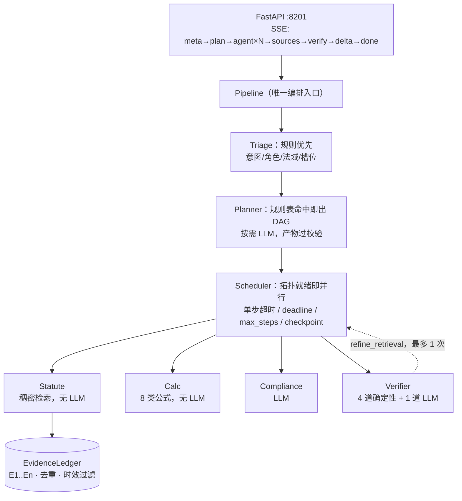

# LexSynergy · 法律合规多智能体专家问答系统

面向中国劳动用工合规场景的多智能体系统：**分诊 → 按需调度专家取证/测算/审查 → 汇总 → 引用校验 →（必要时）补检索一轮**。
四个专家里有三个不含 LLM（检索、测算、四道校验闸），唯一用 LLM 判断的是合规审查与"语义支撑"校验。

> 设计：`docs/01-项目设计与架构方案.md`（三项目梳理与整体设计）、`docs/02-技术决策与实施方案.md`（决策与实施）
> 架构决策：`docs/adr/0001-a2a-sdk-version.md`（SDK 选型）
> 评测：`REPORT.md`（真实语料 1,465 条 + 检索消融 + 校验结果）

**当前状态**：语料与稠密检索、8 类测算、五道闸、编排与 A2A 协议、LLM 三件
（Triage / 六段式撰稿 / G4）、四档对照实验、成本感知路由、协作时间线前端、
**多跳/复杂题扩标（130 条评测集）**、**撰稿流式化（首字快速通道 <1s）**、
**支撑率换独立 judge（3 次重跑漂移 0.0051）** 均已完成并验收。
- 单测 **245 passed / 2 skipped**（零网络零容器）；种子缺陷 **8/8 检出、0 误报**；金额金标 **30/30**
- 默认走成本感知路由（`ROUTING_POLICY=auto`）：单跳题走快速通道，要算钱/多跳/企业方才升级全编排
- `--no-llm` 一键切回纯规则链路（零 token）；`--policy fast|full` 可强制档位

---

> **接手者请先读 `handoff/00-README-先读我.md`** —— 那里有项目定位、进度、下一步与禁区，
> 能在 20 分钟内建立完整上下文。

## 一、三条命令跑起来

```bash
# 0) 环境
uv venv --python 3.13
uv pip install "a2a-sdk[http-server]==0.3.22" fastapi "uvicorn[standard]" httpx numpy \
  pytest pytest-asyncio
uv pip install torch --index-url https://download.pytorch.org/whl/cpu && uv pip install transformers

# 1) 语料（1,465 条法条，硬校验 98/107/1260）
python -m scripts.build_corpus

# 2) 向量（CPU 约 4 分钟，产出 6MB dense.npy）
python -m scripts.build_embeddings

# 3) 跑一个问题
python -m app.runtime ask "被违法辞退的赔偿金怎么算？和 N、2N 是什么关系？" \
  --facts '{"monthly_wage":20000,"start_date":"2023-03-01","end_date":"2026-10-20"}'
```

```bash
# 4) 复现简历上的每一个数字（四档对照，约 11 分钟 / 约 900 次调用）
python -m eval.compare_agents --faithfulness
python -m eval.compare_agents --law-set eval/qa_set_130.jsonl --reuse   # 130 条集
python -m eval.recall_eval --ablate
python -m eval.seeded_defect
```

```
【结论】按你提供的事实，违法解除赔偿金约为 160000.00 元。
【依据】《中华人民共和国劳动合同法》·第七章·第八十七条（E1）：“用人单位违反本法规定解除或者终止劳动合同的，
        应当依照本法第四十七条规定的经济补偿标准的二倍向劳动者支付赔偿金。”
        《中华人民共和国劳动合同法》·第四章·第四十七条（E2）：“经济补偿按劳动者在本单位工作的年限……”
【计算】违法解除赔偿金：2 × N × 月工资基数 = 2 × 4 × 20000 = 160000.00 元
--- route=calc loops=0 llm_calls=0 elapsed=… backend=dense
    verify: passed=True action=pass fails=[]
```

> 首次调用会加载 bge-m3（CPU 约 14s），之后每次检索 ~0.4s。
> 想跳过模型加载：`--backend bm25`（R@5 0.59，零依赖）。

## 二、实测（详见 REPORT.md）

| 项 | 结果 | 复现 |
|---|---|---|
| 语料 | 1,465 条 / 2,935 块，条数校验 **98 / 107 / 1260 全对**，截断率 **0.00%** | `scripts.build_corpus` |
| 检索 R@5 | **0.7381**（稠密，追平 LawAnswer 的 0.7405） | `eval.recall_eval --ablate` |
| 检索 MRR | **0.7476**（LawAnswer 0.7324，**+1.5pt**） | 同上 |
| 引用校验 | 种子缺陷 **8/8 检出、0 误报**（5 道闸全覆盖） | `eval.seeded_defect` |
| 单测 | **245 passed / 2 skipped**，零网络零容器 | `pytest -o addopts="" -q` |
| 测算链路 LLM 调用 | **0 次**（检索 + 测算全确定性） | `ask` 的执行摘要 |
| A2A 跨进程 | ✅ 真实 HTTP 往返，`input_required` 缺槽位跨协议不丢 | `tests/test_a2a_integration.py` |
| 金额准确率 | 单 Agent **56.7%** → 全编排 **100%**（30 条，含边界用例） | `eval.compare_agents` |
| 支撑率 | C **0.954** / D 0.947 / B 0.930 / A 0.925（130 条 × 3 次重跑，最大漂移 **0.0051**） | `eval.faithfulness --repeats 3` |
| 法条问答 R@5 | 单 Agent 0.713 → 全编排 **0.772**（130 条）；100 条集为 0.746 → 0.795 | 同上 |

## 三、检索消融（40 条标注样本）

| 组 | 配置 | R@5 | R@8 | MRR |
|---|---|---|---|---|
| L0 | BM25 | 0.4119 | 0.4833 | 0.4905 |
| L1 | BM25 + Query 扩展 | 0.5857 | 0.7119 | 0.6272 |
| **L2** | **稠密 bge-m3** | **0.7381** | 0.7690 | **0.7476** |
| L3 | 稠密 + BM25 加权 RRF | 0.7167 | **0.7833** | 0.7057 |

三条结论（详见 REPORT §3）：
1. **词项路单独不可行**（0.41），语义鸿沟只能靠稠密补；
2. **Query 扩展对词项路有效 +17.4pt**，但补不全 —— 保留它是因为零成本、对术语题仍有价值；
3. **混合不一定更好**：等权 RRF 只有 0.5786（比纯稠密低 16pt），降到 0.3 权重才回到 0.7167 —— R@5 仍输、R@8 赢。
   默认用 `dense`；接 reranker 后应切 `hybrid`（深召回对重排更友好）。

## 三之二、四档对照：多 Agent 值不值，值在哪

100 条标注样本（40 条原始 + 60 条生成），同检索器、同模型，只动编排与校验。
完整设计与偏差说明见 `docs/04`、`docs/05`，数据与区间见 `REPORT.md` §9.1–§9.3。
2026-10-28 又补了 30 条多跳/复杂题（共 **130 条**，见 `docs/07`），重算结果在下面单独列。

| 配置 | R@5 | 引注可溯 | 引用命中 | 金额准确率 | LLM/题 | 中位延迟 |
|---|---|---|---|---|---|---|
| **A** 单 Agent（复刻 LawAnswer 链路） | 0.746 | 0.985 | 0.731 | 0.567 | **1.00** | **2.4s** |
| **B** 多 Agent，无校验 | 0.781 | 0.998 | 0.714 | **1.000** | 2.04 | 4.9s |
| **C** 多 Agent + 五道闸 | **0.795** | **1.000** | **0.783** | **1.000** | 3.47 | 6.2s |
| **D** 成本感知路由（默认） | 0.776 | **1.000** | 0.708 | **1.000** | 1.59 | 3.7s |

**三处差异的 95% 区间不含 0（配对 bootstrap，100 题重采样）**：

| 对照 | 指标 | 差值 | 95% 区间 |
|---|---|---|---|
| **C − B**（同拓扑，只差校验器） | 引用命中 | **+6.9pt** | [+2.2, +12.2] |
| C − A | 引注可溯 | +1.5pt | [+0.5, +2.8] |
| D − A | 引注可溯 | +1.5pt | [+0.5, +2.8] |

**其余全部落在噪声里**，包括 C − A 的引用命中（+5.3pt，区间 [−3.4, +13.7]）。
这一条推翻了我上一轮在 40 条样本上的结论。正确的表述是：

> 引用质量的收益来自**校验 + 补检索回路**（C−B 可区分），
> 不是来自"把任务拆给多个专家"（B−A 不可区分，甚至 −1.7pt）。

### 130 条集（2026-10-28 扩样）

| 配置 | R@5 | 引注可溯 | 引用命中 | LLM/题 | 中位延迟 |
|---|---|---|---|---|---|
| **A** 单 Agent | 0.713 | 0.973 | 0.714 | **1.00** | **2.4s** |
| **B** 多 Agent，无校验 | 0.765 | 0.996 | 0.696 | 2.03 | 5.0s |
| **C** 多 Agent + 五道闸 | **0.772** | **0.998** | **0.759** | 3.36 | 6.5s |
| **D** 成本感知路由 | 0.753 | 0.997 | 0.681 | 1.75 | 3.9s |

区间不含 0 的差异：C−B 引用命中 **+6.3pt [+2.7,+10.5]**；C−A 引注可溯 +2.6pt；
**D−C 引用命中 −7.9pt [−15.4,−0.5]**。两处旧结论被推翻：

1. **"复杂题 +19pt"不成立**：复杂题扩到 13 条后，A 0.609 → C 0.622（+1.3pt，
   区间 [−0.160,+0.173]）。旧 +19pt 是 8 条样本上的点估计。
2. **"D 与 C 质量分不出来"不成立**：D 确实更便宜，但引用质量**可区分地更低**。

代价与结论：

* C 的成本是 A 的 3.4 倍、中位延迟 2.7 倍；
* D 只要 C 的 52% 成本、60% 中位延迟，金额准确率与 C 持平；
  代价是引用命中低 7.9pt（130 条上区间不含 0，且快速通道没有补检索回路）；
* 所以默认走 D（`ROUTING_POLICY=auto`：130 题里多数单跳题走快速通道），
  对引用质量零容忍的场景用满血版：`ROUTING_POLICY=full`。

**唯一 categorical（非统计）的优势**是校验能力本身：种子缺陷 8/8 检出（A 档 0/8，因为根本没有闸），
以及"每个引用都带裁决"这件事本身。

## 四、架构



**协议边界**：专家以 A2A 服务暴露（`AgentCard` + `DataPart` 结构化产物），业务逻辑写在
`Agent.run()` 里，executor 只做 40 行协议适配 —— 单测直调 `run()`，不启容器。
传输可切：`AGENT_TRANSPORT=inproc | a2a`。

## 五、五道闸（核心增量）

| 闸 | 查什么 | 抓什么错误 | LLM |
|---|---|---|---|
| G1 | 条号是否真实存在于证据 | 编造引用 / 张冠李戴 / 跨法拼接 | ✗ |
| G2 | 引文与原文是否逐字一致（允许"……"显式省略） | 篡改引文 | ✗ |
| G3 | `as_of` 时该条是否有效 | 引用已废止版本 | ✗ |
| G4 | 该条是否**支撑这句话** | 引对了条文却支撑不了结论（Mode 2） | ✓ |
| G5 | 金额是否等于公式结果 | 算错赔偿金 | ✗ |

裁决三态：`pass` / `refine_retrieval` / `downgrade`（金额错只标红不改写）。
回路**硬上限 1 次** + 全局 25s deadline。

三类失败走三种修法（这是实测调出来的，不是设计出来的）：

| 失败 | 修法 | 成本 |
|---|---|---|
| G1 引用了没检索到的条号 | 补检索 → **复查原稿**（多半不用重写） | 0 次 LLM |
| G2 引文对、条号错 | **引文自动对位**（改标签，不改文字） | 0 次 LLM |
| G4 断言无依据 | 重写 | 2 次 LLM |

两个在评测里暴露、随后被修掉的实现 bug（都写了回归测试）：

* **引文错位**：原来在 ±120/40 字符窗口里找"最近的引号"，密集引用段落会抓到邻居条文的引文，
  G2 一次误报 8 条。现在只认"引文与条号之间只剩标点/括号/E 编号"的绑定关系。
* **法名简称**：答案写"《劳动合同法》第四十一条"会被判"条号不存在"（账本按全称拼 key）。
  账本加了唯一后缀解析，简称不再触发假阳性 G1。

## 五之二、协作时间线（前端）

零构建：一个 html + 一个 js + 一个 css，浏览器直接跑，不装 npm。

```bash
uvicorn app.api.main:app --host 127.0.0.1 --port 8201   # 打开 http://127.0.0.1:8201
```

页面三块，全部由 SSE 事件驱动（`meta → plan → agent×N → sources → verify → delta → done`）：

| 区域 | 内容 | 对应事件 |
|---|---|---|
| 答案 | 真流式增量输出（`append`），校验后用终稿整体覆盖；`《法》第X条` 高亮为引用 | `delta` |
| 证据 | E1..En + 法名条号 + 相关度 + 原文前 90 字 | `sources` |
| 时间线 | 定档与理由 → 计划 DAG → 每个专家的状态/耗时/证据数 → 校验裁决 → 完成 | `meta`/`plan`/`agent`/`verify`/`done` |
| 校验 | 通过/未通过 + 具体失败闸 + 引文对位记录 | `verify` |

**只演示成功路径的界面是骗人的**，所以：未过闸的答案会整体标红，风险告示放在答案**顶部**，
时间线上列出失败的闸；`mode`（快速通道 / 全编排）与理由直接显示，让人看出这次为什么快、为什么慢。

首字延迟（阶段 8，`eval.latency_probe`）：快速通道 **P50 753ms / P95 798ms**，
撰稿首字 P50 612ms；全编排的请求级首字仍 ~3.4s，瓶颈是 LLM 分诊而不是撰稿。
总时长不变 —— 流式改的是体感，不是吞吐。

## 六、模型调用（阿里云百炼）

| 用途 | 模型 | 说明 |
|---|---|---|
| 文本生成（Triage / 撰稿 / G4） | **`deepseek-v4.1-flash`** | 统一使用，OpenAI 兼容端点 |
| 稠密检索（默认） | bge-m3（本地，1024 维） | 已建索引；换模型必须重建索引并重测 |
| 稠密检索（备选） | `qwen3.7-text-embedding-flash` | 无 torch 环境时用，同维但**向量不可互换** |

```bash
python -m scripts.check_llm --embedding   # 换 Key/换模型后先跑它
```

三个必须知道的坑（详见 `docs/03-模型调用配置.md`）：

1. **思考模式默认开**：`max_tokens=16` 时 token 全进 `reasoning_content`，`content` 返回空。
   每个请求显式带 `enable_thinking: false` 后，同样问题从 33 token 降到 **2 token**。
2. **`stream_options` 必须与 `stream=true` 成对出现**，否则 400。
3. **JSON 模式不保证 schema**：实测出现过键名改写（`intent` → `int#`），因此字段校验与规则回落不可省。

正常路径 **3 次 LLM**（Triage → 撰稿 → G4）；实测法条问答平均 3.62 次（40 题里 14 题走了一轮回路）。

> 一次实验性发现：**Triage 会把"问规则"的问题误判成"要算钱"**，于是弹"请提供月薪和起止日期"，
> 40 题里有 15 题掉进这个坑。现在加了判定：*缺槽位且问题没索要具体金额 → 不算钱，直接讲规则*。
> 修完降到 2 题。这类问题只有跑端到端评测才看得见。

## 七、目录

```
app/
├── ingest/       ★ 复用 LawAnswer：清洗/康熙归一/结构识别/父子分块（零外部依赖）
├── calc/         8 类公式，30+ 边界用例
├── evidence/     Evidence + Ledger（编号/去重/时效/预算）
├── verifier/     五道闸 + 裁决
├── orchestrator/ rules / planner / scheduler / pipeline / cache / context
├── agents/       base + statute / calc / compliance / verifier
├── protocol/     executor / invoker（inproc|http）/ server
├── retrieval/    bm25 / expand / corpus / dense / embedder
├── api/          FastAPI + SSE
└── runtime.py    装配 + CLI（ask / cards / agent）
data/
├── raw/          3 部法律 Markdown（复用 LawAnswer）
└── corpus/       articles.jsonl / chunks.jsonl / dense.npy / manifest.json
eval/             评测
├── recall_eval     检索消融（4 组）
├── seeded_defect   种子缺陷（8 类错误 × 检出/误报）
├── compare_agents  四档对照（A/B/C/D）★ 简历数字来源
├── baseline_agent  单 Agent 基线（复刻 LawAnswer 链路）
├── gen_multihop    多跳题生成（条组合 → 出题 → 必要性校验）
├── faithfulness    支撑率评测（独立 judge + 3 次重跑验漂移）
├── calc_cases      测算金标 30 条
└── results/        逐题原始输出 + 汇总
web/              前端（index.html / app.js / style.css，零构建）
handoff/          ★ 交接文档（10 份）：项目交接、阶段计划、验收规范、禁区清单
tests/            245 个离线用例（+2 个默认跳过的 A2A 集成）
```

## 八、已知边界（别被"多智能体"三个字骗了）

1. **G4 的离线评测仍用词法代理**（`eval/seeded_defect`），LLM judge 只在真实问答里跑过；
   两者的检出率/误报率需要同一套扩样后重测。阶段 9 只解决了"支撑率可复现"
   （独立判官 + 3 次重跑，漂移 0.0051），**没有**证明判官本身正确。
2. **召回未达设计目标 0.85**：130 条集 R@5 0.713~0.772，缺口在多跳/复杂题（引用命中 0.60~0.66）。
3. **多 Agent 的收益是可区分的部分很小**：130 条样本上，只有"校验器带来的引用命中 +6.3pt"
   （C−B，区间 [+0.027,+0.105]）站得住；C−A 的 +4.5pt、多跳/复杂题上的收益都落在噪声里。
   **100 条集里"复杂题 +19pt"扩样后不成立**（13 条上只有 +1.3pt，区间 [−0.160,+0.173]），
   已在 `REPORT.md` §9.4 明确作废。金额 56.7%→100% 是真的（30 条），但归因是"确定性引擎"
   而非"多 Agent"。支撑率已换独立判官重测（0.925 / 0.930 / 0.954 / 0.947，漂移 0.0051），
   旧口径的排序被推翻，但新数字仍**没有配对区间**（见 `docs/08`）。
   另外 D 档（成本感知路由）在 130 条上引用命中比 C 低 7.9pt 且区间不含 0——
   "用一半的钱买到同样质量"这句旧结论不成立，改写成"更便宜但确实更低"。
4. **G4 偏保守**：实测会把"复述用户事实"和"复述计算结果"误判为无依据，
   已通过把两者作为权威背景注入修正；更细的口径还需扩样验证。
5. **`--no-llm` 不做事实抽取**：规则版 Triage 只做关键词路由，不从自然语言里抽月薪/日期，
   所以走这条路径必须给全 `--facts`（否则会触发追问，这是预期行为）。
6. **尾延迟**：已加请求级总闸（`REQUEST_DEADLINE_S=45`）与"超时不重试"，
   超时降级为模板答案并标 `timeout`。130 条集 C 档 P95 28s（含 2 道 45s 超时题，
   剔除后 22.9s），仍主要耗在撰稿与分诊；多跳题要跑多路检索，尾延迟比单跳题高。
   流式只降低首字体感，不降低总时长 —— 不要把两者混为一谈。
7. **服务首次启动需预热**：bge-m3 冷启动 6~20s，已由 `/api/chat/stream` 所在的 app
   在 lifespan 里后台预热检索器；若不预热，首个用户会拿到"检索超时"（把冷启动
   伪装成知识边界，属于最不该出现的错误，已加测试盯住）。

## 九、待办

| 优先级 | 事项 |
|---|---|
| P5 | 种子缺陷扩到 8 类 × 5 条（含 LLM judge 版）；抽 100+ 条扩样重跑对照 |
| P1 | 路由判据从关键词升级为分类器（需先扩样到 100+ 条，当前 49 条不够拟合） |
| P4 | 前端复用 LawAnswer 6 页 + 协作时间线（SSE 事件已就绪） |
| P2 | 全编排请求级首字 <1s：给 LLM 分诊做缓存 / 小模型（撰稿已达标） |
| P2 | 接 bge-reranker（权重已在本地），切 `hybrid` 后端 |
| P3 | 多轮追问：把 `INPUT_REQUIRED` 的槽位回填到会话状态（当前每题独立） |

---

免责声明：本系统输出为辅助分析，不构成法律意见；具体以裁判机关认定为准。
