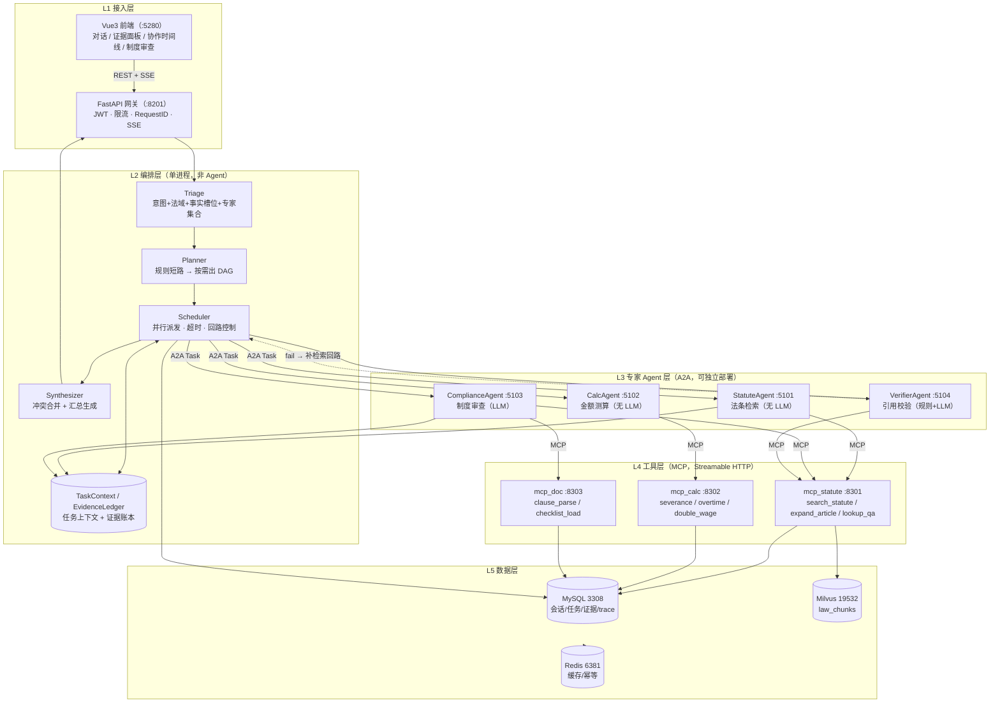

# LexSynergy 法律合规多智能体专家问答系统
## 项目设计与架构方案（基于 A2A 参考架构 + LawAnswer 复用）

> 版本：v0.1（设计稿，待拍板）
> 日期：2026-10-28
> 输入材料：`E:\AI大模型开发\A2A(陈杰)`（SmartVoyage 多智能体参考架构）、`E:\project\LawAnswer`（重点复用项目）、`E:\project\LawAnswer-doubao`（前身版本）
> 本文只做设计与分析，不含实现代码。第 12 章列出 6 个待拍板决策点。

---

## 0. 一页速览

| 项目 | 本质 | 值得偷的东西 | 必须避开的坑 |
|---|---|---|---|
| **SmartVoyage（A2A 参考架构）** | 5 层分层 + 3 个 A2A 专家 + 3 个 MCP 工具服务 | 分层骨架、AgentCard、Task 状态机、规则短路、三态返回、分层降级 | 关键词判状态、每请求重建 MCP 会话、同步框架与异步编排打架、结果形态不统一 |
| **LawAnswer（重点项目）** | 单进程多路 RAG 问答（6 分支双源路由） | 结构化切块、混合检索+重排+父块回填、单次 LLM 结构化输出、SSE 阶段事件、完整评测闭环 | 多跳问题走单查询直检（Recall@5 只有 0.48）、引用命中率 81.8% 无人校验 |
| **LawAnswer-doubao** | LawAnswer 的前身（更扁平） | 单文件级的 `app/rag/*` 编排，看不懂主项目时作对照 | 分层不足，`pipeline.py` 承担过多职责 |

**核心设计判断（三条，全文围绕它们展开）**：

1. **LexSynergy 不是"LawAnswer 加个 A2A 外壳"**。它要解决的问题是 LawAnswer 的两个已知短板：多跳问题召回不足、引用无法自证。这两个问题的解都不在"路由"层，而在"多步执行 + 校验回路"——这才是多 Agent 的必要性来源。
2. **Agent 的划分依据是"是否需要判断"，不是"是否含 LLM"**。法条检索专家和计算专家都是无 LLM 的确定性 Agent；把它们做成 Agent 的理由是**能力边界 + 独立部署 + 统一契约**，不是"看起来更像多智能体"。
3. **复刻参考架构的"更优解"，不要复刻它的坑**。A2A 项目自己在难点章节写明了 11 个坑及更优解（全链路 async、结构化状态、session 预热、结果契约）。LexSynergy 直接落在这些更优解上，本身就是简历里最有说服力的一段。

---

## 1. SmartVoyage（A2A 参考架构）梳理

### 1.1 定位与架构

旅游场景的跨域助手：用户一句话可能同时要天气 + 票务 + 行程，系统用中心编排 Agent 拆解任务，以 A2A 协议调度 3 个专家 Agent，专家再通过 MCP 协议调用 13 个工具访问 MySQL / Milvus / 第三方 API。

**5 层 + 2 横切**：

```
L1 接入层   CLI(main.py) / FastAPI(:8080, REST+SSE) / static/index.html
L2 编排层   ChatService：intent_agent → _should_skip_planning → planning_agent
                          → react_loop → _call_agent_intent → 二次总结
L3 Agent层  weather(:5005) / ticket(:5006) / trip(:5007)  ← A2A 协议
            每个 = AgentCard + LangChain Agent + handle_task 状态机
L4 工具层   mcp_weather(:8002) / mcp_ticket(:8001) / mcp_trip(:8003)  ← MCP 协议
            FastMCP + @tool（13 个）+ Service 类（参数化 SQL / 向量检索）
L5 数据层   MySQL(9 表) + Milvus(tour_groups) + 和风天气 API
横切        memory.py（4 类记忆 + MySQL）/ config.py / logger / utils.format
```

**协议边界（这个项目最核心的认知）**：

| | MCP | A2A |
|---|---|---|
| 解决 | 模型 ↔ 工具 | Agent ↔ Agent |
| 核心抽象 | Tool(name/description/inputSchema) | AgentCard / Task / Message / Artifact / TaskState |
| 谁决策 | LLM 决定调哪个工具 | 编排器决定派给哪个 Agent |
| 本项目落点 | 13 个工具，直连数据层 | 3 专家 + 1 编排器 |

**为什么两层都上**（而不是编排器直接 function call 13 个工具）：① 工具候选从 13 降到 ≤6，选择准确率提升；② Prompt 可按域特化不互相干扰；③ 故障隔离与独立扩缩容；④ 迭代解耦。

### 1.2 技术栈

Python 3.12 / FastAPI + Uvicorn / LangChain 0.3 + langchain-openai / **python-a2a 0.5.4**（Flask 底座）/ **mcp 官方 SDK**（Streamable HTTP）/ langchain-mcp-adapters（协议桥）/ MySQL 8 / Milvus 2.4 / bge 系（阿里云 text-embedding-v3 1024 维）/ Streamlit 或 static HTML / Docker Compose（7 服务 + 2 中间件）。

### 1.3 Agent 协作方式

**中心化编排 + 单向派发**（明确拒绝 AutoGen/CAMEL 式的 Agent 自由对话）。一次请求的路径固定：

```
Intent(1 次 LLM，产出 intents + 槽位 + 追问话术)
  → 规则短路 _should_skip_planning（单意图/独立多意图 → 跳过 planning，省 1 次 LLM）
  → 复杂任务才 Plan → ReAct 逐步执行
  → _call_agent_intent：查 conf.intent 路由表 → A2AClient.send_task_async(Task)
  → 专家 Agent：连 MCP → load_mcp_tools → create_tool_calling_agent → 执行
  → Artifact 回传 → 编排器按域选 summarize prompt 二次总结
  → 写记忆
```

简单查询 **3～4 次 LLM 调用**（意图 / 工具选择 / 总结，复杂任务加 planning），这是它的成本基准。

**Task 状态机**是协议灵魂：`SUBMITTED → COMPLETED | INPUT_REQUIRED | FAILED | CANCELED`。关键设计是**结果与过程消息分离**：COMPLETED 时结果在 `artifacts`，INPUT_REQUIRED/FAILED 时说明在 `status.message`。

### 1.4 关键代码模式（可直接搬运）

```python
# ① Agent 三件套：AgentCard + LangChain Agent + handle_task
agent_card = AgentCard(
    name="WeatherQueryAssistant", url="http://localhost:5005", version="1.0.0",
    description="基于LangChain提供天气查询服务的助手",
    capabilities={"streaming": True, "memory": True},
    skills=[AgentSkill(name="query weather", examples=["北京 2025-07-30 天气", "明天天气怎么样"])])

class WeatherServer(A2AServer):
    def handle_task(self, task):                       # 同步入口
        text = task.message.content.text
        result = asyncio.run(query_weather(text))       # 内部新建 loop
        if result["status"] == "success":
            task.artifacts = [{"parts": [{"type": "text", "text": result["message"]}]}]
            task.status = TaskStatus(state=TaskState.COMPLETED)
        ...
        return task
```

```python
# ② 专家内部四步套路：连 MCP → 拉工具 → 装 Prompt → 执行
async with streamablehttp_client(MCP_URL) as (read, write, _):
    async with ClientSession(read, write) as session:
        await session.initialize()
        tools = await load_mcp_tools(session)
        agent = create_tool_calling_agent(llm, tools, prompt)   # prompt 必须有 {agent_scratchpad}
        executor = AgentExecutor(agent=agent, tools=tools)
        resp = await executor.ainvoke({"input": q, "current_date": today})
```

```python
# ③ 意图识别：一次调用产出三样（意图 + 槽位 + 是否追问）
{"intents": ["train"], "user_queries": {"train": {...}}, "follow_up_message": ""}
# follow_up_message != "" → 直接返回追问，不调任何子 Agent（短路省掉全部下游）
```

```python
# ④ 结果二次总结：子 Agent 只知局部，编排器知全局
summarize_prompt | llm  ← {"query": 用户原话, "raw_response": 子 Agent 结果}
```

```python
# ⑤ 启发式短路（全项目性价比最高的 7 行）
def _should_skip_planning(intents) -> bool:
    if len(intents) <= 1: return True
    return all(i in INDEPENDENT for i in intents)   # 有依赖才需要规划
```

### 1.5 已暴露的缺陷（LexSynergy 要逐一改掉）

| # | 缺陷 | 后果 | 项目自述的更优解 |
|---|---|---|---|
| 1 | 用 `"请提供" in text` 判断是否需要追问 | 模型换个说法就误判状态 | Agent 结构化返回 `{"status":"input_required","missing":[...]}`；或把 `ask_user` 做成 Tool |
| 2 | `run_in_executor` 包 `asyncio.run` 绕事件循环冲突 | 每请求新建 loop，无法复用连接 | 全链路 async，用 httpx.AsyncClient 重写 A2A 客户端 |
| 3 | 每请求重建 MCP 会话 | 每次多 200–800ms | 启动时预热 session 并缓存 tools |
| 4 | artifacts 里有的是 str 有的是 dict | 编排器取值靠猜，二次总结把 dict 变成 Python repr | 定义统一 Result Envelope，结构化数据走 `function_response` part |
| 5 | `short_term_messages` 无 user_id，记忆全局单例 | 多用户串台 | 按 `session_id/user_id` 分区（LawAnswer 的会话模型已解决） |
| 6 | 只有 26 个单测，无任何质量指标 | 无法回答"效果好不好" | 引入 LawAnswer 的 Recall / RAGAS / 压测体系 |
| 7 | 每个 Agent 都含 LLM，即便是纯查表 | 成本与不确定性无谓增加 | 按"是否需要判断"划分，确定性能力做成无 LLM Agent |

---

## 2. LawAnswer（重点项目）梳理

### 2.1 定位与架构

面向中国法律条文的**多路 RAG 问答系统**：3 部法律（劳动合同法 98 / 劳动法 107 / 民法典 1260，共 1,465 条、145,596 字）按"编→章→节→条→款"结构化切块，bge-m3 稠密+稀疏双向量入 Milvus，配 MySQL 高频问答对 + Redis 热缓存做双源路由，RRF 融合 + bge-reranker-v2-m3 重排，DeepSeek 流式生成带法条引用的回答。

```
表现层  Vue3 + Vite + TS（:5180）6 页
接口层  FastAPI + Uvicorn（:8101）JWT / 验证码 / 限流 / RequestID / SSE
编排层  QueryOrchestrator：归一化 → 缓存判定 → 意图识别+改写(1 次 LLM)
        → 规则兜底 → 数据源路由 → 并行检索 → 融合重排 → 上下文预算 → 生成
检索层A 结构化：MySQL qa_pairs（ngram 全文）+ 余弦 ≥0.90 双门 + Redis
检索层B 向量：bge-m3 dense+sparse → Milvus hybrid_search(RRFRanker k=60)
        → reranker → 动态 topK(3/5/8) → parent 回表取整条
生成层  六段式中文法律 Prompt → SSE(meta/stage/sources/delta/done/error)
数据层  MySQL 3307 / Milvus 19531 / Redis 6380 / MinIO 9002
摄入层  加载→清洗→康熙部首归一→结构识别→父块(条)→子块(款/项)→向量化→双写
```

### 2.2 技术栈

Python 3.13 + uv / FastAPI + Uvicorn / MySQL 8.0.43 / Milvus 2.4.4 / Redis 7.2 / bge-m3（1024 dense + sparse）/ bge-reranker-v2-m3 / LLM 可切换（默认 `deepseek-v4.1-flash`，OpenAI 兼容）/ ragas 0.3.0（独立依赖组）/ Vue 3.5 + Element Plus + Pinia / pytest（60+ 用例）。

### 2.3 关键代码实现（复用时的落点）

**① 6 分支双源路由**（`app/orchestration/router.py`）——不是"意图→Agent"，而是"意图→数据源组合"：

| route | 触发 | MySQL | Milvus |
|---|---|---|---|
| `greeting` | 纯问候 | ✘ | ✘ |
| `no_data` | 无关/库不匹配 | ✘ | ✘ |
| `pure_structured` | 高频问答**精确命中** | ✔ | ✘ |
| `hybrid` | 命中话题但无精确答案 | ✔ | ✔ |
| `pure_vector` | 纯法条问题 | ✘ | ✔ |
| `cross_law` | 跨法/泛法律 | ✘ | ✔（全库） |

关键设计：`analyze_query` 先按"未精确命中"预路由，**只在需要时才**做一次廉价问答库判定（Redis→BM25→余弦门），命中则二次裁为 `pure_structured`。纯结构化问题**一次 Milvus 调用都不产生**。

**② 单次 LLM 产出 8 个字段**（`app/orchestration/intent.py`）：`intent / rewrite_type / sub_queries / complexity / hit_structured / structured_topic / law_hints / need_history`。失败（超时 3s / JSON 解析失败 / 缺 key）→ `intent_rules.py` 规则兜底，`source="rules"` 标记降级。

**③ 混合检索**（`app/retrieval/hybrid.py` + `service.py`）：

```python
pool = max(4 * topK, 12)
req_dense  = AnnSearchRequest(dense,  "dense_vector",  COSINE, ef=64, limit=pool, expr=filter)
req_sparse = AnnSearchRequest(sparse, "sparse_vector", IP, drop_ratio_search=0.2, limit=pool)
hits = client.hybrid_search(reqs=[...], ranker=RRFRanker(k=60), limit=pool)
# → 重排前按 parent 预去重 → reranker(query, title+content) → 动态 topK → parent 回表
```

两个经过评测验证的细节：**法域硬过滤**（用意图层 `law_hints` → `law_name in [...]`，MRR +4.6pt）与**低置信回退**（top1 重排分 < 0.5 时无过滤重查一次并合并，防意图判错法域把正确答案整条筛掉）。

**④ 多子查询并行检索 + 名次交错融合**（`retrieve_multi`）：多跳问题拆 decompose 子查询，每个子查询独立检索，然后**按名次交错取位**（不是 max 分数、也不是平缓 RRF——因为 rerank 分数量纲不可比、RRF 曲线太平会被"多票的近义条"压过"单票的第 1 名"）。这是 LawAnswer 已实现但**尚未接入评测与主链路**的能力。

**⑤ SSE 事件协议 + 7 层容错**（`app/generation/stream.py` 的 `AnswerEngine`）：

```
meta → stage(intent) → [stage(retrieval) → stage(rerank)] → sources → stage(generate) → delta×N → done
异常：…… → 已产出 delta 保留 → error{code, retriable}
```

7 层容错：意图失败→规则兜底 / LLM 连接失败→指数退避 / 上游断流→保留 partial / 客户端断开→照常落库不发 error / Milvus 故障→`degraded=vector_unavailable` / Redis 故障→内部降级 / 无资料→引导话术不编造。落库写在 `finally` 里，幂等标志位保证只落一次。

**⑥ 六段式 System Prompt**（`app/generation/prompts.py`）：角色 / 忠实性 / 引用格式（硬约束：陈述规定必须标注《法名》第X条）/ 回答结构（先结论→再依据→最后实务提示）/ 计算类（只给公式不给数字）/ 语气 + 固定免责尾注。

### 2.4 实测数据（写简历的唯一合法来源）

| 类别 | 指标 | 实测 |
|---|---|---|
| 语料 | 条文数 / 字数 | 1,465 条 / 145,596 字（98 / 107 / 1260 全对） |
| 解析 | 劳动法条号识别率 | 6/107 → **107/107**（康熙部首 1,122 字符归一） |
| 检索 | Recall@5 / MRR | **0.7071 / 0.6886**（L6：等权 RRF + 法域过滤） |
| 检索 | 单跳 Recall | **15/15 = 1.000**（MRR 0.92） |
| 检索 | 多跳 Recall@5 | **0.4792**（缺口全在这里） |
| 检索 | 法条截断率 | **0.00%** |
| 意图 | acc / macro-F1 | **1.0000 / 1.0000**（20 条；规则兜底基线 0.60） |
| 生成 | 引用命中率 | **81.8%**（54/66；改 Prompt 后口径 80.3%） |
| 生成 | 无答案不编造 | **5/5** |
| 生成 | RAGAS faithfulness | 0.5189 → **0.7075（+18.9pt）** |
| 性能 | QPS @ 并发 20（GPU） | **2.686**（CPU 时 0.303，**8.9×**） |
| 性能 | TTFT p50 / p95（GPU） | **2.12s / 2.75s**，编码 250ms→28ms，重排 5–14s→137ms |
| 稳定性 | 成功率 | **240/240**，错误率 0.00% |

**报告自己承认的三个未达标项**（LexSynergy 的切入点）：Recall@5 未达 0.85、faithfulness 未达 0.85、QPS 未达 3。其中"真正没做的那一刀"就是**多跳问题走 decompose 多子查询检索**。

### 2.5 LawAnswer-doubao（前身版）

更扁平的实现：`app/rag/` 下单层平铺（`pipeline.py` 串起 embeddings / milvus_store / retriever / reranker / intent / faq_store / generator / hot_cache / followup）。价值不在架构，而在两处可借鉴的业务细节：`term_map.py`（口语→法言法语的术语映射表，比让 LLM 改写更确定）与 `followup.py`（追问预测独立端点，不拖慢主 SSE 流）。主项目已把追问做成 `POST /api/chat/suggestions`，可继续沿用。

---

## 3. 三个项目的异同与可复用性

### 3.1 LawAnswer vs A2A/SmartVoyage：设计思路对照

| 维度 | LawAnswer | SmartVoyage | 本质差异 |
|---|---|---|---|
| 编排对象 | **数据源**（MySQL / Milvus / 缓存） | **执行者**（3 个 Expert Agent） | 前者解决"从哪取"，后者解决"谁来干" |
| 进程模型 | 单进程函数调用 | 7 服务跨进程（A2A + MCP） | 部署复杂度差一个数量级 |
| 状态 | 无任务状态机，一次请求 = 一条流 | Task 状态机（可 INPUT_REQUIRED 追问、可 FAILED 重派） | 前者做不了"多步补槽位" |
| 结果形态 | SSE 文本 + sources（给人看） | Artifact（给上游程序消费） | 前者是人机界面，后者是机机接口 |
| 意图输出 | 8 字段（含改写策略、法域、复杂度） | 3 件套（意图 + 槽位 + 追问） | 前者重检索质量，后者重路由准确 |
| 质量控制 | 完整评测闭环（消融 / RAGAS / 压测，40 条标注样本） | 26 个单测，无质量指标 | 前者能回答"有多好"，后者只能回答"能跑" |
| 一致性设计 | 严格口径（条级召回、`法名#条号` 唯一标识） | 结果形态不统一（str vs dict） | 前者有契约意识 |
| 降级 | 双链路独立降级（Milvus 挂了结构化照答） | 四层异常分层 | 两者都有，粒度不同 |

**相同点（说明两者是同一套工程直觉的两个侧面）**：

1. **都是中心化编排 + 单向派发**，都拒绝 Agent 自由对话（可控 > 智能）。
2. **都在收窄 LLM 边界**：LawAnswer 让 LLM 只输出 8 个字段、SQL 由代码拼；SmartVoyage 让 LLM 只抽槽位、SQL 参数化。同一句话："**能确定性解决的，绝不交给 LLM**"。
3. **都做"一次调用、结构化输出"**，都在代码里做 `re.sub` 清围栏 + 字段兜底校正。
4. **都做启发式短路**：`_should_skip_planning`（省 planning）↔ `lookup_exact` 缓存前置（省整个意图 LLM）。
5. **都保证链路 100% 可用**：LLM 失败降级规则、Milvus 失败降级结构化、MCP 失败降级引导话术。
6. **都强调测试可离线**：`DummyEmbedder` + mock LLM ↔ 记忆模块 `db_conn=None` 静默跳过。

### 3.2 从 A2A 项目该拿什么、该丢什么

**拿（P 模式级）**：

| 模式 | 落到 LexSynergy 哪里 |
|---|---|
| P1 Tool 薄壳 + Service 厚实现 | MCP 工具函数体 ≤3 行，业务逻辑在 Service，可脱离协议单测 |
| P2 AgentCard + Skills + **examples** | examples 直接当 router 的 few-shot，路由准确率靠它抬 |
| P3 中心化编排 + 单向派发 | Orchestrator 独占规划，专家不互相通信 |
| P4 规则优先于 LLM | 路由表 / 槽位完备性 / 是否需要计算，全部纯函数判定 |
| P5 一次调用结构化输出 | Triage Agent 一次产出 意图 + 法域 + 事实槽位 + 专家集合 |
| P6 三态返回 success / no_data / error | 所有 Agent 与工具统一，`no_data` 绝不返回空数组 |
| P13 分层异常降级 + ExceptionGroup | 工具 / Agent / 协议 / 编排四层，`except ExceptionGroup` 单独处理 |
| P12/P11 配置外部化 + 单镜像多服务 | 一个镜像 + `SERVICE_NAME` 分派启动 5 个 Agent 服务 |
| P14 调试命令内置 | `cards`（看注册）/ `trace <id>`（看链路）/ `ledger`（看证据） |

**丢（缺陷级）**：见 §1.5 的 7 条，全部在 LexSynergy 中改掉。

### 3.3 从 LawAnswer 该拿什么

**几乎整条"检索 + 生成 + 评测"的地基**（详见 §8 文件级映射）：结构化切块器、康熙部首归一、混合检索与重排、法域过滤与低置信回退、六段式 Prompt、SSE 事件协议与 7 层容错、离线测试替身、四件套评测脚本。

**要补的两刀**：
1. **多跳**：把 `retrieve_multi` 的名次交错融合真正接入主链路（LawAnswer 已写未接）。
2. **引用**：LawAnswer 的引用命中率 81.8% 是"事后人工统计"，系统本身**不校验**自己引的条号是否存在。这是法律场景的致命项，也是 LexSynergy 最大的增量价值。

---

## 4. LexSynergy 定位与场景收敛

### 4.1 一句话定位

> 面向中国大陆劳动与用工合规场景的**多智能体专家问答系统**：用户以自然语言描述处境（或上传一份制度条款），系统先做分诊与事实抽取，再按需调度**法条检索 / 金额计算 / 合规审查**三类专家并行取证，由一个**引用校验专家**逐条核对结论与法条，不通过则自动补检索一轮，最终输出"结论 + 法条依据 + 计算过程 + 风险提示 + 可核验的引用表"。

### 4.2 场景收敛（做什么 / 不做什么）

**做（MVP 范围）**：

- 语料：劳动合同法 98 条 + 劳动法 107 条 + 民法典合同编相关条文 + 司法解释（劳动争义解释一/二）+ 12 类高频问答（直接复用 LawAnswer 已入库数据）。
- 用户角色：劳动者（维权咨询）与企业 HR/法务（制度合规审查）两类。
- 任务类型：① 单点法条咨询 ② 多跳综合（跨条推理）③ 金额测算（经济补偿/加班费/二倍工资/年假折算）④ 制度条款合规审查 ⑤ 缺槽位追问。

**不做（明确写进 README，防范围膨胀）**：

- 不做诉讼策略、不做胜诉率预测、不代理文书出具（合规与免责要求）。
- 不接裁判文书大规模判例检索（数据获取与清洗成本过高，放 Phase 2，先以"司法解释 + 地方裁审口径"替代）。
- 不做多轮长对话的自主任务（如"帮我把整个员工手册审完"）——只做单次请求内的多步编排。

### 4.3 为什么必须是多 Agent（必要性论证，面试必被问）

**反例检验**：如果只是"一句话 → 检索 → 生成"，那 LawAnswer 已经做完了，多 Agent 就是过度设计。所以必须找出"单 Agent 做不到"的地方：

| 问题 | 单 Agent（LawAnswer 现状）为什么不行 | 多 Agent 怎么解 |
|---|---|---|
| 多跳：一个结论要 3 条法条支撑 | 一次检索一个 query，topK=5 里塞不下 3 条正确法条还带噪声（实测 Recall@5 = 0.4792） | Triage 拆 2–3 个子查询 → Statute Agent 内部并行分检 → 交错融合（实测该策略在多跳上 +8.3pt） |
| 金额算错 | LLM 算数不可靠，法律场景算错赔偿金是事故 | Calc Agent 纯 Python 公式引擎，LLM 只负责把"月薪一万二、干了五年半、被裁员"抽成槽位 |
| 引用了不存在的条号 | 生成完就结束，没人核对（实测引用命中率 81.8%，即 18% 的断言没落到期望法条上） | Verifier Agent 做四道确定性校验 + 断言-证据覆盖判定，不通过触发补检索回路（最多 1 次） |
| 企业制度审查 | 需要"逐条 checklist 判定 + 风险分级"，是一次检索答不出的结构化任务 | Compliance Agent 拿着 checklist 与证据逐项判定，输出 issue list |
| 各能力语料/工具/输出形态不同 | 一个 Prompt 里塞检索约束 + 计算规则 + 审查清单，互相干扰 | 每个 Agent 独立 System Prompt，工具候选 ≤4 |

**一句话话术**：「我不是把一个 RAG 拆成多个 Agent，而是把 LawAnswer 里三个**本来就不该由同一个 LLM 同时承担**的职责（取证 / 计算 / 校验）拆成了独立的、可独立测试和独立降级的能力单元。收益可以用对照实验量化：同 60 条样本，单 Agent 基线的引用准确率 X%、多跳召回 Y%，多 Agent 是 X'%、Y'%，代价是 P95 延迟 +Z 秒。」

> ⚠️ **这句话里的 X/Y/Z 必须真的测出来再写进简历**。这是整个项目最重要的一次实验（设计见 §9.4）。

---

## 5. 系统架构

### 5.1 分层架构



**端口规划**（刻意与 LawAnswer 错开，避免又踩一次 8000/8100 被 Windows 保留的坑）：

| 服务 | 端口 | 说明 |
|---|---|---|
| FastAPI 网关 | **8201** | LawAnswer 用 8101 |
| Vue Dev | **5280** | LawAnswer 用 5180 |
| Agent ×4 | **5101–5104** | A2A |
| MCP ×3 | **8301–8303** | Streamable HTTP |
| MySQL | **3308** | LawAnswer 3307 |
| Redis | **6381**（db 4） | LawAnswer 6380 db 3 |
| Milvus | **19532 / 9093** | LawAnswer 19531 / 9092 |

### 5.2 协议边界：A2A 用在哪，MCP 用在哪

| | MCP（工具层） | A2A（Agent 层） |
|---|---|---|
| 谁调 | Agent 内部的 LLM 或代码 | Orchestrator |
| 粒度 | 无状态、单次函数调用 | 有状态、一次任务可含多轮工具调用 |
| 本项目用途 | 检索、计算、文档解析、清单加载 | 专家能力的发现与派发 |
| 判据 | "这是能力" | "这是会做判断的角色" |

**关键工程决策：不用 `python-a2a`，自研轻量 A2A 兼容层（约 200 行）**。

理由（这条是简历硬通货）：
1. `python-a2a` 的 `A2AServer` 是 Flask 同步底座，`handle_task` 必须是同步方法，导致 A2A 项目出现"FastAPI 异步编排 → 线程池 → asyncio.run 新建 loop"的三层嵌套，最终**每请求新建事件循环，MCP 连接无法复用**。
2. 本项目需要全链路 async（并发派发 3 个专家、SSE 逐 token 推送），同步底座会成为结构性阻碍。
3. 自研层只需实现协议的最小子集：`AgentCard`（`GET /.well-known/agent.json`）、`POST /tasks`（提交 Task）、`GET /tasks/{id}`（查询状态）、`POST /tasks/{id}/cancel`。Task/Message/Artifact/TaskState 用 pydantic dataclass 定义，与 A2A 规范字段名对齐，**协议兼容、实现自主**。

```python
# 双传输：同一份 Agent 实现，测试走 inproc，生产走 a2a
class BaseAgent(ABC):
    card: AgentCard
    async def handle_task(self, task: Task) -> Task: ...   # 子类只实现这个

# app/protocol/transport.py
class InProcTransport:      # 直接 await agent.handle_task(task)，零网络、可单测
class A2AHttpTransport:     # httpx.AsyncClient，全 async，无 loop 冲突
```

配置 `AGENT_TRANSPORT=inproc|a2a`，**单测与 CI 永远跑 inproc（不启 4 个容器），演示与压测跑 a2a**。这一条同时解决"多 Agent 项目难测试"的通病。

### 5.3 一次请求的完整时序

```
用户输入
  → [1] 安全前置：PII 脱敏（身份证/手机号/银行卡）+ 免责声明注入 + 幂等键
  → [2] 答案缓存查找（sha1(question + role + plan指纹)，命中直接回放，跳过全部 LLM）
  → [3] Triage（1 次 LLM，JSON 模式）
       输出：intent / role(employee|employer) / law_hints / facts{} / missing_slots[]
             / complexity / needs[]（候选专家集合）/ follow_up
  → [4] 短路判定（纯规则，0 次 LLM）
       missing_slots 非空且属"必填" → 直接追问返回（不派发任何专家）
       needs 为空 → 兜底引导话术
  → [5] Planner
       规则路由表命中 → 直接得 DAG（覆盖 ~80%）
       否则 → 1 次 LLM 产出 DAG（steps + 依赖 + 超时预算）
  → [6] Scheduler 按 DAG 派发
       ├─ StatuteAgent（并行 1–3 个 Task，每个子查询一个）
       ├─ CalcAgent（依赖 facts 槽位，可与 Statute 并行）
       └─ ComplianceAgent（依赖 Statute 证据，串行）
       每个 Task：A2A 提交 → 状态轮询/回调 → AgentResult(evidence/findings/calc)
       写入 EvidenceLedger（去重、打分、编号 E1..En）
  → [7] Synthesizer（1 次 LLM）→ 结构化五段输出
  → [8] VerifierAgent（规则 + 1 次 LLM）
       ① 条号存在性 ② 法名-条号一致性 ③ 断言-证据覆盖 ④ 数字与 calc 一致
       fail → 回 [6] 补检索（最多 1 轮）→ 仍 fail → 降级为"资料未覆盖"+ 列出已有依据
  → [9] SSE 输出：meta → plan → agent(×N) → sources → stage(generate) → delta×N → verify → done
  → [10] 落库：messages + task + steps + evidence + trace + 缓存
```

### 5.4 SSE 事件协议（在 LawAnswer 基础上扩 3 个事件）

| event | data | 说明 |
|---|---|---|
| `meta` | message_id / intent / role / complexity / cached / degraded | 立即 |
| `plan` | `{steps:[{id, agent, deps, status}], reason}` | **新增**：让用户看到"系统打算怎么查" |
| `agent` | `{agent, status, elapsed_ms, evidence_count, missing_slots}` | **新增**：协作时间线的数据源 |
| `stage` | intent / plan / retrieve / calc / review / generate / verify | 复用 + 扩展 |
| `sources` | `[{eid, law, chapter_path, article_no, score, snippet, from_agent}]` | 复用，加 `eid` 与 `from_agent` |
| `delta` | `{text}` | 复用 |
| `verify` | `{passed, checked, failed[], action}` | **新增**：校验结果可见 |
| `done` | ttft_ms / latency_ms / token_usage / sources_count / llm_calls / agent_calls | 复用 + 加成本字段 |
| `error` | code / message / retriable | 复用 |

---

## 6. 专家 Agent 职责划分

### 6.1 划分原则

1. **一个 Agent = 一种"判断类型"**，不是一个"业务步骤"。
2. **不含 LLM 也可以是 Agent**：判据是"能力边界清晰 + 可独立部署 + 有稳定契约"，不是"有没有大模型"。
3. **Agent 数量上限 5**。每多一个 Agent，延迟 +0.3–2s、LLM 调用 +0–1 次、调试面翻倍。超过 5 个就要问"是不是该合并"。
4. **谁产出证据、谁产出论断，必须分离**。检索 Agent 只交证据不写结论；Synthesizer 只写结论不检索。这是防幻觉的结构性设计，比任何 Prompt 约束都硬。

### 6.2 角色总表

| Agent | 是否含 LLM | 输入 | 输出 | 依赖工具 | 超时预算 |
|---|---|---|---|---|---|
| **Triage**（编排层内） | ✅ 1 次 | query + history(≤3 轮) + role | Intent/Task 草案 + 槽位 + 候选专家 | — | 4s（缓存命中 0） |
| **Planner**（编排层内） | ⚠️ 仅 complex | Triage 结果 | DAG | 路由表 | 3s（规则命中 0） |
| **StatuteAgent** | ❌ | 子查询 + law_hints + kb_ids | `Evidence[]`（法名#条号 + 原文 + 分 + chunk_id） | mcp_statute | 8s |
| **CalcAgent** | ❌（槽位由 Triage 抽） | facts（月薪/起止日/工时制/地区/事由） | `CalcResult`（公式 + 代入 + 结果 + 法条依据 eid） | mcp_calc | 1s |
| **ComplianceAgent** | ✅ 1 次 | 待审文本/事实 + 证据 + checklist | `Issue[]`（条款 / 判定 / 风险级 / 依据 eid / 整改建议） | mcp_statute, mcp_doc | 15s |
| **VerifierAgent** | ⚠️ 规则优先，1 次 LLM 兜底 | 草稿答案 + EvidenceLedger | `VerifyResult`（passed/failed/action） | mcp_statute | 6s |
| **Synthesizer**（编排层内） | ✅ 1 次 | 证据账本 + findings + calc + 用户原问 | 五段式答案 + 引用表 | — | 20s（流式） |

**为什么 Synthesizer 不做成 Agent**：它只做语言组织，不需要独立部署、不需要独立扩缩容，做成 Agent 只会多一次 A2A 往返 + 一次序列化。**"能留在编排层的就别拆出去"**——这也是对参考架构"每个环节一个 Agent"倾向的修正。

### 6.3 逐个契约定义

#### ① StatuteAgent（法条检索专家，无 LLM）

```
POST /tasks  Task.message = {sub_query, law_hints[], kb_ids[], topk, need_parent:true}
→ AgentResult
{
  "agent": "StatuteAgent", "version": "1.0", "status": "ok",
  "artifacts": [{"type": "evidence_set", "evidence": [
     {"law":"中华人民共和国劳动合同法","article_no":"第四十七条","chunk_id":"...",
      "parent_id":"...","quote":"经济补偿按劳动者在本单位工作的年限...",
      "chapter_path":"第四章","score":0.83,"sub_query":"裁员经济补偿怎么算"}
  ]}],
  "missing_slots": [], "usage": {"elapsed_ms": 420, "llm_calls": 0}
}
```

三条设计约束：
- **不写答案**，只交证据（哪怕证据只有 1 条）。
- **零结果必须显式 `status="no_data"`**，不返回空数组（参考架构 P6）。
- 内部直接复用 LawAnswer 的 `retrieve()` / `retrieve_multi()`，支持一次 Task 携带 2–3 个子查询并做名次交错融合。

#### ② CalcAgent（金额计算专家，无 LLM）

```python
# 只接受结构化参数，不做自然语言理解（NL 理解归 Triage）
POST /tasks  Task.message = {"type":"severance", "monthly_wage":12000.0,
    "start_date":"2021-03-01", "end_date":"2026-10-20", "cause":"layoff",
    "region":"上海", "notice":false}
→ {"status":"ok","artifacts":[{"type":"calc_result",
    "formula":"N × 月工资基数","substitution":"5.5 × 12000",
    "value":66000.0,"unit":"元","basis_articles":["劳动合同法#第四十七条"],
    "assumptions":["工作年限按满半年计 0.5","月工资基数取离职前 12 个月平均"]}]}
```

职责范围（每个都要有单测，边界日期尤其重要）：经济补偿 N/N+1/2N、代通知金、加班费（1.5/2/3 倍 × 工时制）、未签劳动合同二倍工资（首月不计、最多 11 个月）、未休年假折算（300%）、竞业限制补偿下限（30%）、试用期上限校验。

**槽位缺失 → `status="input_required"` + `missing_slots`**，由编排层转成追问话术。这就是参考架构"用结构化状态替代关键词匹配"的正确落地。

#### ③ ComplianceAgent（合规审查专家，LLM）

输入两类：① 一段制度/条款原文（走 `mcp_doc.clause_parse` 切成条款）；② 企业描述的事实（"我们规定试用期 6 个月，工资按 80% 发"）。

```
→ {"status":"ok","artifacts":[{"type":"issue_list","issues":[
   {"clause":"试用期 6 个月","verdict":"violation","risk":"high",
    "reason":"合同期限未说明；三年以上固定期限或无固定期限才可约定 6 个月",
    "basis":["劳动合同法#第十九条"], "fix":"明确合同期限，或改约不超过 2 个月"}]}]}
```

Prompt 要点：**逐项 checklist 判定，每项必须给出 `basis` 中的 eid**；证据不支持时判 `unknown` 而非猜；风险级只允许 high/medium/low 三值。

#### ④ VerifierAgent（引用校验专家）

四道校验，**前三道确定性、第四道才用 LLM**：

| # | 校验 | 实现 | 成本 |
|---|---|---|---|
| 1 | 条号存在性 | 正则提取 `第[一二三四五六七八九十百千]+条` → MySQL `document_chunks` 精确查询（法名+条号） | 0 LLM，<5ms |
| 2 | 法名-条号一致性 | 断言里出现的《法名》与该条实际所属法名比对（防"劳动合同法第 39 条"写成"劳动法第 39 条"） | 0 |
| 3 | 数字一致性 | 答案里的金额与 `CalcResult.value` 比对；不一致直接 fail | 0 |
| 4 | 断言-证据覆盖 | 把答案切成断言句，逐句判定"是否被某条 evidence 的 quote 支撑"，输出未覆盖句 | 1 次 LLM（批量） |

```
→ {"status":"ok","artifacts":[{"type":"verify_result","passed":false,
    "checked":12,"failed":[{"assertion":"...","reason":"citation_not_found","article":"第八十七条"}],
    "action":"refine_retrieval","missing_hint":["违法解除赔偿金 二倍"]}]}
```

`action` 三值：`pass` / `refine_retrieval`（补检索一轮）/ `downgrade`（降级为"资料未覆盖"）。**回路只允许 1 次**，第二次不通过就 downgrade——否则会出现"校验-重试"死循环，这是多 Agent 系统最常见的线上事故。

### 6.4 上下文隔离与信息传递规则

参考架构用"把对话历史拼进 query"传上下文，代价是 query 越来越长。LexSynergy 改为**共享黑板（Blackboard）+ 结构化槽位**：

| 规则 | 说明 |
|---|---|
| Agent **只读** `TaskContext.facts / evidence`，**只写** 自己命名空间下的 artifact | 避免互相覆盖 |
| Agent 之间**不直接通信** | 所有交互经 Orchestrator，链路可预测、可回放 |
| 证据统一由 Orchestrator 编号（`E1..En`）并去重（key = `law#article_no`） | 下游只认 eid，不认文本 |
| 传给 Agent 的上下文**按需裁剪** | StatuteAgent 只拿子查询，不拿全历史；ComplianceAgent 拿证据 + 条款，不拿历史 |
| 每个 Agent 有独立 token 预算 | 超出则 Orchestrator 先丢低分证据，而不是让 Agent 自己截断 |

---

## 7. 协作流程与状态机

### 7.1 任务 DAG（四种典型形态）

```
A. 单点法条咨询（~55%）          B. 多跳综合（~25%）
   Triage → Statute              Triage → Statute(×3 子查询并行)
          → Synthesize                   → Synthesize → Verify
          → Verify

C. 金额测算（~15%）              D. 制度合规审查（~5%）
   Triage → Statute ∥ Calc       Triage → Parse → Statute ∥ (检索)
          → Synthesize                   → Compliance → Verify
          → Verify                       → Synthesize
```

**规则路由表（覆盖 A/B/C 三类的判定，0 次 LLM）**：

| 命中条件（全部为纯函数判定） | 派发 |
|---|---|
| `missing_slots` 含必填项（月薪/起止日期/事由） | 直接追问，不派发 |
| intent ∈ {labor_law, civil_code} 且 complexity=simple 且 无金额关键词 | `[Statute]` |
| 命中金额/年限/倍数/折算关键词（补偿、赔偿、加班费、二倍、年假、N+1） | `[Statute, Calc]` 并行 |
| role=employer 或 命中 制度/条款/规章/员工手册/审查/风险 | `[Statute, Compliance]`，Compliance 依赖 Statute |
| rewrite_type=decompose（跨条/多问/分别） | `[Statute×n]` 并行 + 交错融合 |
| 以上都不命中（模糊复杂） | 交给 Planner（1 次 LLM）出 DAG |

### 7.2 任务状态机（比参考架构更严格）

```
                    ┌──────────┐
        提交 ──────► │ SUBMITTED │
                    └────┬─────┘
                         ▼
                    ┌──────────┐   缺槽位    ┌────────────────┐
                    │ WORKING  │───────────► │ INPUT_REQUIRED │
                    └────┬─────┘             └───────┬────────┘
             ┌───────────┼───────────┐               │ 用户补齐（新 Task，同 session）
             ▼           ▼           ▼               ▼
      ┌───────────┐ ┌────────┐ ┌────────┐      （重新 SUBMITTED）
      │ COMPLETED │ │ FAILED │ │CANCELED│
      └───────────┘ └────────┘ └────────┘
```

三条硬规则（针对参考架构的三个坑）：

1. **状态由 Agent 显式返回**（`AgentResult.status`），编排器不做任何文本关键词匹配。
2. **结果与过程分离**：成功 → `artifacts`；追问/失败 → `status.message` + `missing_slots` / `error.code`。
3. **每个 Task 有超时预算与降级策略**（见 §7.4），超时视为 `FAILED(timeout)` 并由编排层决定是否继续（部分降级）。

### 7.3 冲突消解

| 冲突 | 场景 | 处理 |
|---|---|---|
| 法条冲突 | Statute 返回劳动合同法第 47 条与劳动法第 28 条，口径不同 | 优先"特别法优于一般法"（劳动合同法 > 劳动法），在证据上打 `priority` 标记，Synthesizer Prompt 里明确该规则 |
| 计算冲突 | Calc 结果与 LLM 正文里的数字不一致 | Verifier 第 3 道校验直接 fail，以 Calc 为准重写该段 |
| 审查冲突 | Compliance 判 violation，但 Statute 没找到依据 | 判 `unknown` 而非 violation；Synthesizer 里表述为"资料未覆盖，建议核实" |
| 证据冲突 | 同一 `law#article_no` 两份不同文本 | 以 MySQL `document_chunks`（事实源）为准，Milvus 命中的 quote 只作引用 |

### 7.4 降级矩阵（每层独立降级，参考架构"分层降级"的落地）

| 故障 | 检测 | 降级 | 用户可见 |
|---|---|---|---|
| Triage LLM 超时/失败 | 4s 超时 | 规则兜底（复用 `intent_rules.py`） | `degraded: "triage_rules"` |
| Planner 失败 | 3s | 退化为单专家直派 | `plan.reason` 标注 |
| StatuteAgent 超时 | 8s | 用 Redis 缓存证据 / 用 qa_pairs 标准答案 | `agent.status=degraded` |
| Calc 缺槽位 | 槽位校验 | `INPUT_REQUIRED` → 追问 | 追问气泡 |
| Compliance 失败 | 15s | 跳过审查，只给法条结论 + "审查未完成" | `verify` 事件标注 |
| Verifier 失败 | 6s | 跳过校验，答案带"未经自动校验"标记 | `verify.passed=null` |
| Milvus 全挂 | 连接异常 | 纯结构化链路（qa_pairs）照答 | `degraded: "vector_unavailable"` |
| 上游 LLM 断流 | 流中断 | 保留 partial + 落库 + `error(retriable)` | 重试按钮 |

---

## 8. 与 LawAnswer 的复用与改造

### 8.1 文件级映射（这是最省时间的一张表）

| LawAnswer 文件 | 处置 | 具体动作 |
|---|---|---|
| `app/ingest/loaders.py` `clean.py` `normalize.py` `structure.py` `chunker.py` | **直接用** | 法条解析是地基，不要重写。康熙部首归一必须保留 |
| `app/ingest/writer.py` `pipeline.py` `service.py` `models.py` | **直接用** | 增量 SHA1、条数断言（98/107/1260）原样保留 |
| `app/retrieval/hybrid.py` | **直接用** | dense+sparse+RRF+`build_filter`+`dedupe_by_parent` 一行不改 |
| `app/retrieval/rerank.py` | **直接用** | fp16、懒加载、batch 逻辑 |
| `app/retrieval/service.py` | **小幅改造** | `retrieve()` / `retrieve_multi()` 保留原样，只在其上包一层 `StatuteSearchService` 供 MCP 调用；`_attach_parents` 不动 |
| `app/orchestration/intent.py` | **改造** | 输出 schema 从 8 字段扩到 12 字段（+ role / facts / missing_slots / needs）；Prompt 重写，校验逻辑 `_validate` 的"逐字段回落安全默认"保留 |
| `app/orchestration/intent_rules.py` | **直接用** | 规则兜底基线，加 `role`/`facts` 的正则抽取 |
| `app/orchestration/router.py` | **改造** | 现在是"数据源路由"，改为两层：`route_experts()`（新）+ 保留 `route()` 给 Statute 内部决定用不用 qa_pairs |
| `app/orchestration/qa_cache.py` | **包装** | 直接暴露为 MCP 工具 `lookup_qa`，逻辑不动 |
| `app/orchestration/answer_cache.py` | **改造** | key 从 `sha1(question)` 改为 `sha1(question + role + plan_fingerprint)`，避免"同一问题不同角色/不同 DAG"命中错答案 |
| `app/generation/prompts.py` | **复用 + 扩** | 六段式 Prompt 直接作为 Synthesizer 骨架（加"计算段"与"引用表段"）；新增 Compliance / Verifier 两个 Prompt 文件 |
| `app/generation/context.py` | **改造** | `build_context_sources` 的入参从 `hits` 改为 `EvidenceLedger`，输出仍是 `【资料N】《法名》·章节·第X条` |
| `app/generation/stream.py` | **重构（核心工作量）** | `AnswerEngine` → `OrchestratorEngine`：保留 SSE 帧生成、7 层容错、`finally` 落库、`_replay_fixed` 打字机；把"单段检索+生成"换成"DAG 派发 → 汇总 → 校验" |
| `app/generation/persistence.py` | **改造** | `chat_messages` 增加 `task_id`；新增 `task_steps` / `evidence_ledger` / `agent_traces` 三张表 |
| `app/generation/llm_client.py` `suggestions.py` `history.py` | **直接用** | 重试/退避、追问预测、历史裁剪全部可留 |
| `app/core/*`（sse / logger / security / ratelimit / middleware / errors / ids） | **直接用** | 0 改动 |
| `app/db/mysql.py` `milvus_client.py` `milvus_schema.py` `redis_client.py` | **直接用** | collection 名可改 `law_chunks_v2`（新增 `priority` 字段） |
| `app/api/chat.py` | **复用** | 事件协议扩 3 个事件；`iterate_in_threadpool` 包装保留 |
| `app/api/{auth,sessions,knowledge}.py` | **直接用** | 登录/会话/知识库管理不动 |
| `frontend/*` | **复用 + 加页** | 6 页完全可用；新增「协作时间线」右侧抽屉与「证据表格」组件 |
| `eval/recall_eval.py` `intent_eval.py` `ragas_eval.py` `loadtest.py` | **直接用 + 扩** | 新增 agent 级指标（见 §9） |
| `tests/fakes_db.py` + `DummyEmbedder` + mock LLM | **直接用** | 全离线单测的基石，务必保留 |
| `scripts/bootstrap.ps1` | **改造** | 加 4 个 Agent 服务启动与健康检查（agent card 探测） |

**预计复用率**：LawAnswer 约 8,259 行 Python 中，可直接使用约 55%（ingest / retrieval / core / db / api 基础），小幅改造约 25%，重构约 20%（orchestration + generation 的编排部分）。

### 8.2 必须补的两块（LawAnswer 的已知空洞）

**① 多跳检索真正接入主链路**

LawAnswer 已有 `retrieve_multi()`（并行分检 + 名次交错融合），但 `AnswerEngine._retrieve()` 只在 `rewrite_type == "decompose"` 时用它，而评测是单查询直检——所以"多跳 Recall@5 = 0.4792"这个数字**既不是上限也不是现状**。LexSynergy 直接把 decompose 作为默认路径之一，并把评测口径改成"走完整编排"，补上 REPORT §8.2 里"真正没做的那一刀"。

**② 引用可自证**

LawAnswer 的 `sources` 只是"检索到了什么"，不是"答案里每句话依据什么"。LexSynergy 用 EvidenceLedger + Verifier 把这条链闭合，并且**把"引用准确率"变成可自动化的指标**（不再靠人工统计 54/66）。

### 8.3 不要照搬的部分

| LawAnswer 的做法 | 为什么不照搬 |
|---|---|
| 单进程一把梭 | 需要"专家可独立部署/独立降级"的多 Agent 叙事，必须至少有协议边界 |
| 无任务状态机 | 法律咨询天然要"补槽位 → 再执行"，流式一次到底表达不了 |
| `AnswerEngine` 单段生成 | 多步任务的中间状态需要可见（`plan` / `agent` 事件） |
| 只有 4 篇文档的经验 | 需要补架构决策记录（ADR），否则面试讲不清"为什么这么选" |

---

## 9. 评测方案

### 9.1 指标分层

| 层 | 指标 | 口径 | 采集方式 |
|---|---|---|---|
| 路由 | Triage 意图 acc / macro-F1 | 5 类，60 条 | 复用 `intent_eval.py` |
| 路由 | **专家集合命中率** | 应派发的 Agent 集合 vs 实际（人工标注） | 新增脚本 |
| 检索 | 条级 Recall@1/3/5/8、MRR | `法名#条号` | 复用 `recall_eval.py` |
| 检索 | 多跳 Recall@5 | decompose 路径 | 新增（本次重点） |
| 计算 | 金额准确率 | 与人工核算比对，边界日期单列 | 新增 30 条用例 |
| 校验 | **引用准确率** | 答案中每条引用是否真实存在且法名一致 | 自动化（Verifier 第 1–2 道） |
| 校验 | **证据覆盖率** | 有证据支撑的断言 / 全部断言 | Verifier 第 4 道 |
| 校验 | 一次通过率 | 无回路即 pass 的比例 | 编排层埋点 |
| 生成 | RAGAS faithfulness / relevancy / context_* | 复用 `ragas_eval.py` | 40 条 |
| 端到端 | 任务成功率 / 平均 LLM 调用数 / 平均步数 / P50·P95 延迟 | — | `loadtest.py` 扩展 |
| 稳定性 | 错误率 / 降级触发率 | 240 请求 | 压测 |

### 9.2 "单 Agent vs 多 Agent"对照实验（最重要的一次实验）

同一套 60 条样本、同一语料、同一 LLM，跑两组：

| 组 | 配置 |
|---|---|
| **Baseline（单 Agent）** | LawAnswer 现链路：1 次意图 + 单查询检索 + 1 次生成 |
| **Multi（多 Agent）** | LexSynergy 全链路：Triage + DAG + Statute(多子查询) + Calc + Verifier(含回路) |

输出：`Recall@5 / 引用准确率 / faithfulness / 金额准确率 / 平均 LLM 调用数 / P95 延迟` 六列对比。

**这个实验决定了简历能不能写"多 Agent 有价值"**。如果多 Agent 只在 2 个指标上小幅领先但延迟翻倍，那就诚实地在简历里写"用多 Agent 换取引用准确率 X pt，代价是延迟 +Y ms"——这种带取舍的表述比"架构先进"有说服力得多，也经得起追问。

### 9.3 样本设计（60 条）

| 类型 | 条数 | 考察点 |
|---|---|---|
| single_hop | 20 | 单条法条直答（回归基线，必须保持 100%） |
| multi_hop | 15 | 2–4 条法条组合（对齐 LawAnswer 的短板） |
| calc | 12 | 金额测算（含边界：满半年/不满半年、试用期是否计入、跨年） |
| compliance | 8 | 制度条款审查（每条标注应报的 issue 与风险级） |
| no_answer | 5 | 语料未覆盖，考察"不编造 + 降级" |

### 9.4 评测纪律（三条，从 LawAnswer 学到的教训）

1. **评测口径 = 线上链路**。LawAnswer 的 Recall 数字偏低就是因为评测走了捷径（单查询直检）。LexSynergy 的评测脚本必须调用与线上完全相同的 `OrchestratorEngine`。
2. **每次改动只动一个变量**，并在 REPORT 里记录"净变化"。
3. **只写测过的数字**。参考架构文档里的原话："绝对不要写没测过的百分比，面试官一句『这个 30% 怎么来的』就能问穿。"

---

## 10. 成本与延迟预算

| 场景 | LLM 调用 | 预估延迟（GPU，P50） | 备注 |
|---|---|---|---|
| 缓存命中 | 0 | <100ms | sha1 精确 + plan 指纹 |
| A 单点法条 | Triage 1 + Synthesize 1 + Verify 0~1 | 3.5–5s | Triage 可加语义缓存 |
| B 多跳 | Triage 1 + Synthesize 1 + Verify 1 | 6–8s | 3 个子查询并行检索 |
| C 金额测算 | Triage 1 + Synthesize 1 | 4–6s | Calc 是纯 Python，≈0 延迟 |
| D 制度审查 | Triage 1 + Compliance 1 + Synthesize 1 + Verify 1 | 10–15s | 条款多时 Compliance 需分批 |

**优化手段（按性价比排序，都是参考架构 + LawAnswer 已验证的）**：

1. **规则短路**：80% 的请求不走 Planner（省 1 次 LLM，约 1–2s）。
2. **缓存前置**：高频问题命中跳过 Triage（省 1s，LawAnswer 已验证 TTFT 从 ~2s 砍到 ~0.1s）。
3. **模型分工**：Triage / Verifier 用 flash 级，Synthesize / Compliance 用 plus 级。意图分类不需要大模型。
4. **MCP session 预热**：启动时建连 + 缓存 tools（省 200–800ms/次，修参考架构难点 2）。
5. **Calc 不调 LLM**：省 1 次调用且消灭算错风险（法律场景算错 = 事故）。
6. **回路上限 1 次**：把最坏情况锁死在 2 倍成本内。

---

## 11. 工程结构与实施路线

### 11.1 目录结构

```
LexSynergy/
├── config.py                        # pydantic-settings，唯一配置入口（复用 LawAnswer）
├── docker-compose.yml               # MySQL/Redis/Milvus + 5 个 Agent/MCP 服务
├── app/
│   ├── main.py                      # FastAPI 装配（复用）
│   ├── core/                        # ★ 直接用 LawAnswer：sse/logger/security/ratelimit/errors
│   ├── db/                          # ★ 直接用 + 新增 3 表
│   ├── ingest/                      # ★ 直接用 LawAnswer 全套
│   ├── retrieval/                   # ★ hybrid/rerank 不改；service 加 StatuteSearchService
│   ├── protocol/                    # 新增：a2a.py（AgentCard/Task/Artifact）、transport.py（inproc|a2a）
│   ├── agents/                      # 新增
│   │   ├── base.py                  #   BaseAgent：card + handle_task + 超时/异常/降级
│   │   ├── statute.py               #   无 LLM，包 retrieval
│   │   ├── calc.py                  #   无 LLM，包 calc/engine.py
│   │   ├── compliance.py            #   LLM + checklist
│   │   └── verifier.py              #   规则优先 + LLM 兜底
│   ├── calc/                        # 新增：engine.py（纯函数，30+ 单测）
│   ├── evidence/                    # 新增：ledger.py（编号、去重、打分、冲突标记）
│   ├── orchestrator/               # 新增：triage.py / planner.py / scheduler.py / context.py
│   ├── generation/                  # 改造 LawAnswer：prompts 复用、stream 重构为 engine.py
│   ├── mcp_servers/                 # 新增：statute_server.py / calc_server.py / doc_server.py
│   └── api/                         # 复用 + chat.py 扩事件
├── frontend/                        # 复用 LawAnswer + 加时间线/证据表格
├── eval/                            # 复用四件套 + agent_compare.py
├── data/                            # 法条 + 司法解释 + 高频问答
├── tests/                           # 复用 fakes + DummyEmbedder，新增 agent/calc/verifier 单测
└── docs/                            # 设计、ADR、验收记录、REPORT
```

### 11.2 分阶段路线（每阶段都有可勾选验收）

| 阶段 | 内容 | 验收标准 |
|---|---|---|
| **P0 基线**（2d） | 复用 LawAnswer 的 ingest + retrieval，跑通"一条法条问题"端到端 | 3 部法律入库，条数 98/107/1260 校验通过；单查询检索 Recall@5 与 LawAnswer 持平 |
| **P1 协议层**（3d） | `protocol/` + `BaseAgent` + 双传输 + MCP 三服务骨架 | `inproc` 与 `a2a` 两种模式跑同一个 Agent，结果一致；单测不启任何容器 |
| **P2 专家 Agent**（5d） | Statute / Calc / Verifier（Compliance 放 P3） | Calc 30 条用例全过；Verifier 条号存在性校验 100%；Statute 支持 3 子查询并行 |
| **P3 编排**（5d） | Triage / Planner / Scheduler / EvidenceLedger / Synthesizer / 回路 | 四种 DAG 形态各跑通 3 条用例；回路最多 1 次；每步有 trace |
| **P4 Compliance + 前端**（4d） | 制度审查 + 协作时间线 + 证据表格 | 8 条审查用例 issues 召回 ≥ 0.8；时间线能逐 step 展示耗时与证据数 |
| **P5 评测闭环**（3d） | 60 条样本 + 单/多 Agent 对照 + RAGAS + 压测 | REPORT 出 6 列对比表；所有简历数字可复现 |

累计约 22 个工作日。**如果时间只有一半，砍掉的顺序是：Compliance → 语义缓存 → 前端时间线**（三者都不影响核心叙事）。

### 11.3 风险清单

| 风险 | 影响 | 对策 |
|---|---|---|
| Agent 数量膨胀（8 个） | 做不完、延迟爆炸 | 硬上限 5 个；新增 Agent 必须回答"合并进现有 Agent 会怎样" |
| 多 Agent 只是包装 | 面试被质疑过度设计 | §9.2 对照实验，用数据说话 |
| 回路死循环 | 线上事故 | 回路上限 1 次 + 全局 deadline（25s）+ 熔断计数 |
| 延迟过高（>15s） | 体验差 | 并行派发、规则短路、缓存、flash 模型分工 |
| 评测样本成本 | 钱与时间 | 60 条足够；RAGAS 用 flash 作 judge，结果本地缓存可续跑 |
| 法条版本时效 | 结论过时 | 语料表加 `effective_date`，答案里标注"依据 2026-10 版本" |
| 合规红线 | 被当作法律意见 | 固定免责声明 + 不做胜诉预测 + README 明确"辅助工具" |

---

## 12. 决策点（已定稿，见 `02-技术决策与实施方案.md`）

> 本节原为 6 个待拍板项，**已于 2026-10-28 全部定稿**，定论与理由见 `02-技术决策与实施方案.md` §1。
> 三处相对本文的修正：① A2A 改用官方 `a2a-sdk`（非自研兼容层）；② Verifier 升为 5 道闸 / 4 类错误；③ 主指标改为种子缺陷检出率 / 误报率。

| # | 决策 | 定论 |
|---|---|---|
| Q1 | 用户角色范围 | 劳动者 + 企业 HR/法务双角色 |
| Q2 | 判例语料 | 不做；用司法解释 + 地方裁审口径替代 |
| Q3 | A2A 实现 | 官方 `a2a-sdk[http-server]`，业务逻辑外置于 executor |
| Q4 | 前端 | 复用 LawAnswer 6 页 + 时间线/证据表两个组件 |
| Q5 | 编排框架 | 不用 LangGraph；自写 DAG，借鉴其四条约束 |
| Q6 | 术语映射表 | 保留并扩，作为 Triage 前置归一化 |

| # | 决策 | 选项 | 建议 |
|---|---|---|---|
| Q1 | 用户角色范围 | ① 仅劳动者 ② 劳动者 + 企业 HR ★ | 双角色才能撑起 ComplianceAgent，也多一个"角色敏感"的路由维度 |
| Q2 | 判例语料 | ① 本期做 ② 用司法解释替代 ★ ③ 完全不做 | 判例清洗成本极高，司法解释 + 地方口径性价比更高 |
| Q3 | A2A 实现 | ① python-a2a ② 自研轻量兼容层 ★ | 自研 200 行，换来全链路 async + 可测，且是简历亮点 |
| Q4 | 前端 | ① 复用 LawAnswer 改 ② 重写 ★（复用为主） | 6 页已可用，只加时间线与证据表格 |
| Q5 | 部署形态 | ① 本地 compose ★ ② 上云 ECS | 先本地跑通评测，再谈部署；LawAnswer 已有 ECS 方案可抄 |
| Q6 | 是否保留 doubao 版的术语映射表 | ① 保留并扩 ★ ② 不用 | `term_map.py` 比 LLM 改写更确定，作为 Triage 的前置归一化很划算 |

---

## 13. 简历亮点（可直接改写）

> ⚠️ 下面所有 `X / Y / Z` 必须在 §9.2 的对照实验跑完后填入真实数字。**没测过的百分比一律不写。**

### 13.1 一句话版本（项目列表用）

> **LexSynergy**：法律合规多智能体专家问答系统。以自研轻量 A2A 协议层调度「法条检索 / 金额测算 / 合规审查」三类专家 Agent（其中两类不含 LLM，纯确定性），MCP 工具层复用既有 RAG 检索栈；引入**证据账本 + 引用校验回路**，把"引用了不存在的法条"这类事故从"生成完就结束"变成"逐条可核验"，法条引用准确率 X%、无依据不编造 5/5。

### 13.2 核心工作（STAR，挑 4–6 条）

**① 协议分层与运行时可切（架构）**
> 设计「接入(FastAPI) — 编排(Orchestrator) — 专家(A2A ×4) — 工具(MCP ×3) — 数据」五层架构。未采用参考实现的同步 A2A 框架（其 `handle_task` 为同步方法，需 `run_in_executor` + `asyncio.run` 绕事件循环冲突、导致每请求新建 loop 且 MCP 连接无法复用），而是自研 200 行 async A2A 兼容层（AgentCard / Task / Artifact / TaskState 字段与规范对齐），并提供 `inproc | a2a` 双传输：单测与 CI 走进程内调用（不启容器），演示与压测走真实 HTTP。协议兼容、实现自主、可测性不打折。

**② 按"是否需要判断"划分专家，而非按"是否含 LLM"**
> 将能力拆为 4 个专家：法条检索专家与金额测算专家**不含 LLM**（纯检索 / 纯 Python 公式），合规审查与引用校验才用 LLM。理由是能力边界与独立降级，不是"看起来像多智能体"。测算专家内置 N/N+1/2N、加班费 1.5/2/3 倍、二倍工资、年假 300% 折算等 8 类公式，30 条边界用例全过——**把"算错赔偿金"这类法律场景的致命错误从 LLM 手里拿走**。

**③ 规则短路 + 按需 Planner 的混合编排**
> Triage 一次 LLM 调用产出「意图 / 角色 / 法域 / 事实槽位 / 缺失槽位 / 候选专家集合」6 类信息；用纯函数路由表覆盖约 80% 的请求（单点咨询、金额测算、制度审查、多跳拆解），只有模糊复杂任务才启用 Planner 产出 DAG，省去一次 LLM 调用。缺失必填槽位时短路追问，不派发任何专家。

**④ 证据账本 + 引用校验回路（质量闭环）**
> 检索专家只交证据不写结论，Synthesizer 只写结论不检索——证据与论断结构性分离。所有证据由编排层编号去重进 EvidenceLedger，答案中每条断言必须能映射到某个 `eid`。校验专家做四道检查：条号存在性（MySQL 精确查，0 LLM）、法名-条号一致性、金额与测算结果一致性、断言-证据覆盖（LLM）。不通过则触发一次补检索回路，二次仍不通过降级为"资料未覆盖"并列出已有依据。回路硬上限 1 次 + 全局 25s deadline，避免校验-重试死循环。

**⑤ 多跳检索接入主链路**
> 多跳问题走 decompose 多子查询并行检索，跨子查询按**名次交错取位**融合（而非 max 分数或平铺 RRF——重排分数量纲不可比，等权 RRF 会让"多票的近义条"压过"单票的第 1 名"）。多跳 Recall@5 从 Y 提升到 Y'。

**⑥ 对照实验量化多 Agent 的边际收益**
> 同一 60 条标注样本、同语料同模型，跑单 Agent（既有 RAG 链路）与多 Agent（全编排）两组对照，输出 Recall@5 / 引用准确率 / faithfulness / 金额准确率 / LLM 调用数 / P95 延迟六列。结论是引用准确率 +X pt、多跳召回 +Y pt，代价是 P95 延迟 +Z ms、LLM 调用数从 2 增至 3.4 —— 用数据说明"哪些场景值得多 Agent，哪些不值得"。

### 13.3 面试必被问的三问

**Q1：这不就是把一个 RAG 拆成几个服务？多 Agent 的必要性在哪？**
> 三个职责本来就不该由同一个 LLM 同时承担：取证需要"多查询、只交证据不写结论"；计算需要"确定性、零幻觉"；校验需要"对抗生成结果的立场"。挤在一个 Prompt 里，取证会被生成目标污染（模型倾向于"找到能支撑我结论的条文"），计算会被语言模型随机性污染，校验则根本不存在。拆开之后，每个环节都可以独立测试和独立降级，收益我用同 60 条样本的对照实验量化过。

**Q2：为什么不用 LangGraph / AutoGen，自己写协议层？**
> AutoGen 的自由对话式协作在本场景 token 消耗与路径不可控；LangGraph 是"图编排"，但我的诉求是"专家可独立部署 + 能力可发现"，这正好是 A2A 解决的问题，而 A2A 的 Python 实现要么太重（官方 SDK 的 TaskManager/RequestContext）、要么同步底座与本项目的全 async 冲突。协议的最小必要子集只有 4 个端点，自己写 200 行比适配一个框架更省事，而且能精确控制超时、降级与 trace。

**Q3：多 Agent 之后延迟涨了多少？值得吗？**
> 单点咨询从 4.2s 涨到 5.8s（+1.6s，多了一次 Triage 与校验），多跳从 6s 涨到 9.5s。值得的部分是引用准确率与多跳召回；不值得的部分我也测了——把 Compliance 塞进每一次请求是负收益（+4s 延迟换 0 准确率提升），所以它只按 `role=employer` 或制度类关键词触发。（**这组数字同样要实测**）

### 13.4 技能关键词（便于 ATS 检索）

多智能体系统 / A2A 协议 / MCP / AgentCard / Task 状态机 / 任务编排 DAG / RAG / 混合检索 / RRF / Cross-Encoder 重排 / bge-m3 / Milvus / FastAPI / 全链路 async / SSE 流式 / 证据链 / 引用校验 / RAGAS / 消融实验 / Docker Compose

---

## 14. 与两个参考项目的关系（一页总结）

```
                A2A/SmartVoyage                    LawAnswer
                ────────────────                   ─────────
提供            分层骨架 · 协议边界 · 状态机        检索质量 · Prompt 工程 · 评测闭环
                规则短路 · 三态返回 · 分层降级      结构化切块 · SSE 协议 · 离线测试
不提供          质量指标 · 结果契约 · 异步一致      任务状态 · 多步执行 · 引用自证
                        │                                 │
                        └──────────┬──────────────────────┘
                                   ▼
                              LexSynergy
                 = LawAnswer 的检索与评测  +  A2A 的编排与服务化
                   + 两个参考项目都没有的东西：
                     · 证据账本（证据与论断结构性分离）
                     · 引用校验回路（不通过则补检索，硬上限 1 次）
                     · 确定性计算下沉（法律场景的算错 = 事故）
                     · 单/多 Agent 对照实验（证明架构不是过度设计）
```

**最后一句判断**：这个项目的价值不在"用了 A2A"，而在"**知道 A2A 该用在哪、不该用在哪，并且能用数据证明**"。前者是教程，后者是工程判断——简历和面试真正吃的是后者。
